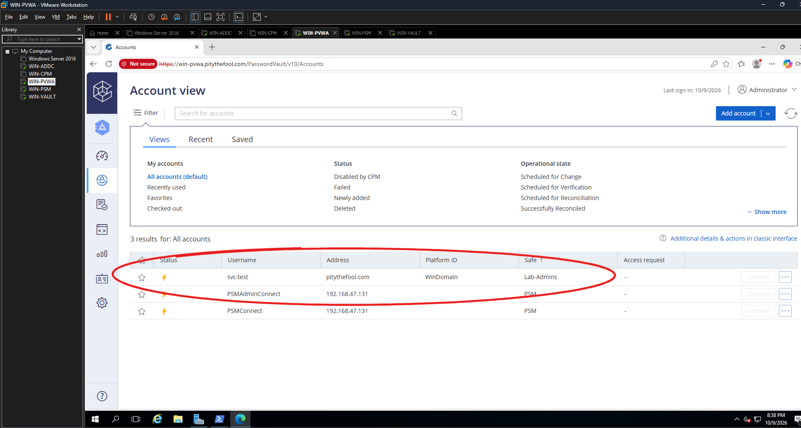
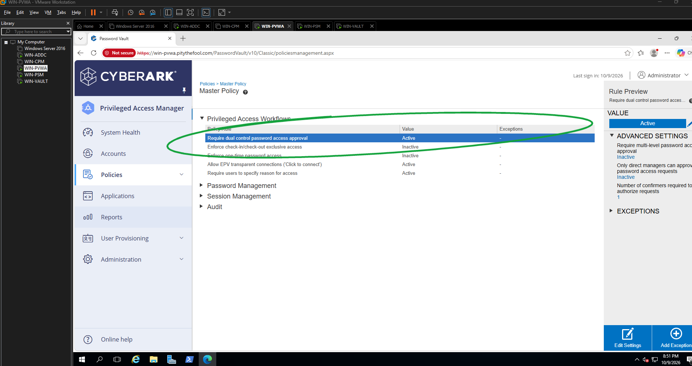
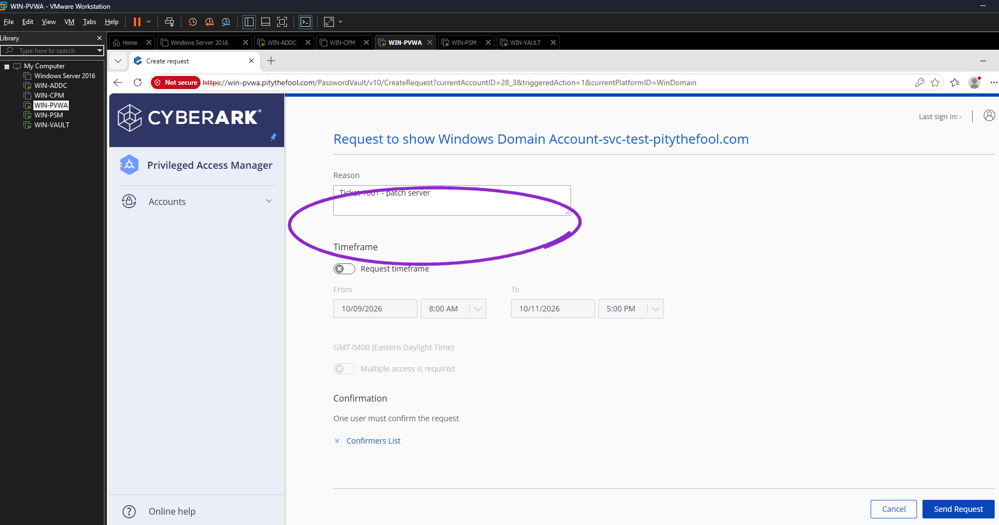
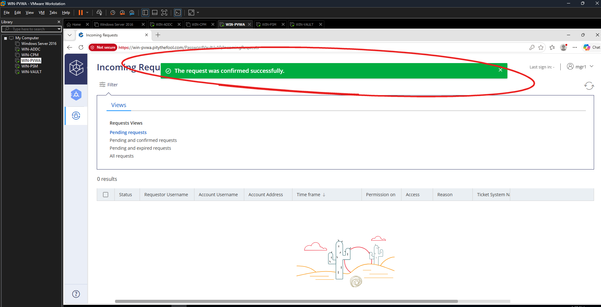
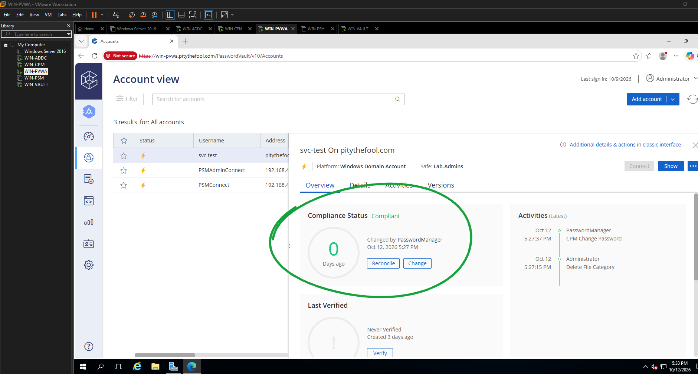
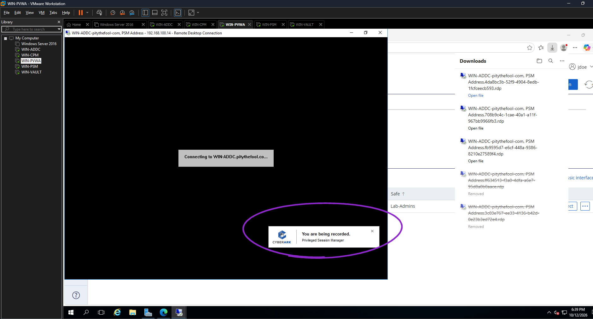
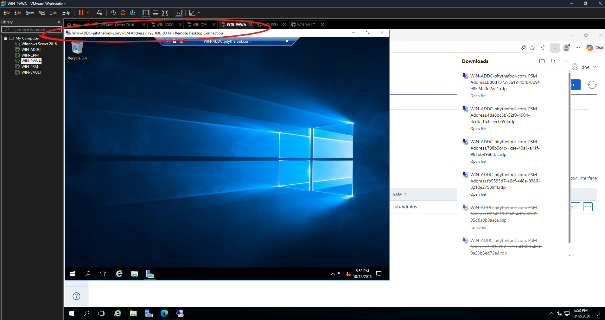
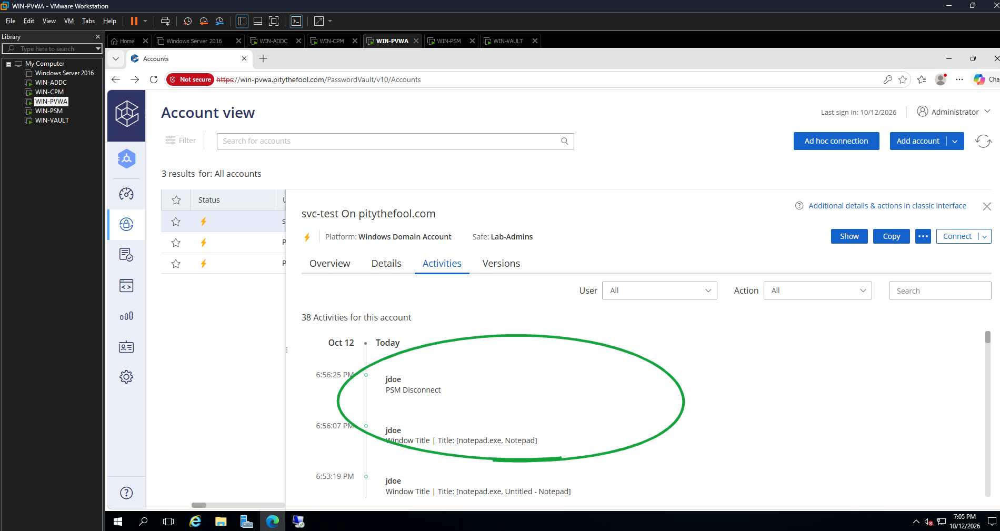
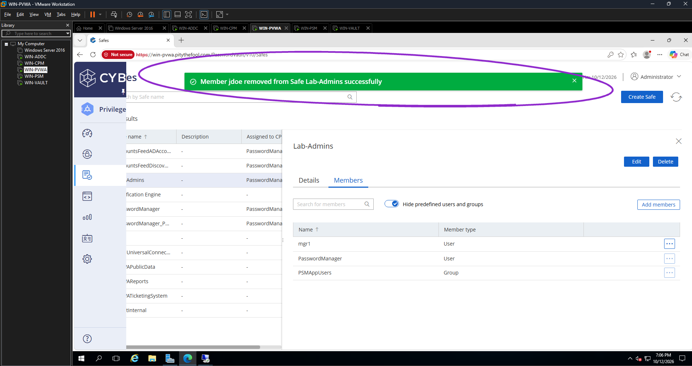
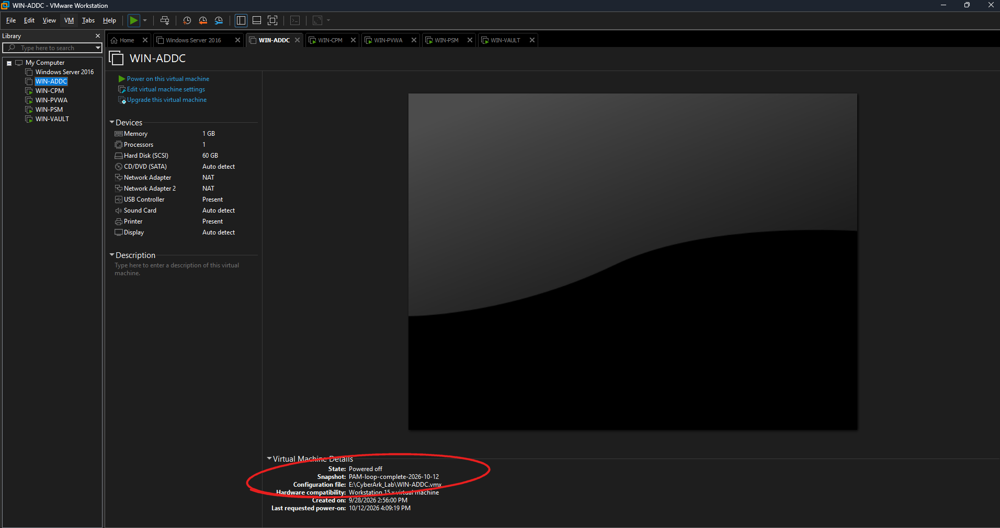

# CyberArk PAM Self-Hosted 12.6 Home Lab

Hands-on lab, Oct 2026.

Ticket-style privileged access loop in **CyberArk PAM Self-Hosted 12.6**: onboard a Domain Admin service account into a safe, make a requester ask for it, make an approver sign off, let CPM rotate the password, open a recorded PSM session, then pull the requester's access.

This is **not** Entra ID, Okta, Windows AD basics, or CyberKy/LLDAP. Those live in other repos.

## Scope

| # | Item | Dump |
| --- | --- | --- |
| 1 | 5 VMs on VMware Workstation, domain **pitythefool.com**, Vault / CPM / PVWA / PSM installed | Done (Oct 2026) |
| 2 | Onboard AD account **svc-test** (Domain Admins) into safe **Lab-Admins**, WinDomain platform | Done (Oct 2026) |
| 3 | Users via PVWA REST API: **jdoe** (requester), **mgr1** (approver) — separation of duties | Done (Oct 2026) |
| 4 | Master Policy: dual control password access approval | Done (Oct 2026) |
| 5 | Request → approve → grant (Ticket 1001) | Done (Oct 2026) |
| 6 | CPM rotation: failed winRc 2245, fixed MinPasswordAge 0, rotated → Compliant | Done (Oct 2026) |
| 7 | PSM monitored session to WIN-ADDC (Tickets 1002/1003), recorded, activities logged | Done (Oct 2026) |
| 8 | Remove jdoe from Lab-Admins | Done (Oct 2026) |
| 9 | All 5 VMs snapshotted as **PAM-loop-complete-2026-10-12** | Done (Oct 2026) |

## Environment

| Object | Value |
| --- | --- |
| Hypervisor | VMware Workstation Pro |
| Domain | `pitythefool.com` |
| WIN-ADDC | 192.168.100.10 — domain controller (AD DS, DNS, DHCP) |
| WIN-VAULT | 192.168.100.11 — Digital Vault 12.6, workgroup (not domain-joined) |
| WIN-CPM | 192.168.100.12 — Central Policy Manager |
| WIN-PVWA | 192.168.100.13 — Password Vault Web Access (`https://win-pvwa.pitythefool.com/PasswordVault`) |
| WIN-PSM | 192.168.100.14 — Privileged Session Manager |
| Target account | `svc-test` (Domain Admins), platform WinDomain, safe **Lab-Admins** |
| Snapshots | All 5 VMs: `PAM-loop-complete-2026-10-12` |
| Requester | `jdoe` (EPVUser, created via REST API) |
| Approver | `mgr1` (Lab-Admins member with approve rights) |

## Screenshots

Ten hero shots, one per loop step. Each has a loose hand-drawn oval on the thing I clicked or the result that matters. All untouched originals are in [`proof/`](proof/) (index at the bottom).

### 1. Onboard: svc-test (Domain Admins) in Lab-Admins, WinDomain platform

### 3. Master Policy: dual control active

### 4a. jdoe requests svc-test with Ticket 1001

### 4b. mgr1 confirms the request

### 5. CPM rotated the password → Compliant

### 6a. PSM: "You are being recorded"

### 6b. PSM session on WIN-ADDC

### 6c. Activities: window title (notepad.exe) + PSM Disconnect

### 7. jdoe removed from Lab-Admins

### 8. Snapshot PAM-loop-complete-2026-10-12

## What was built

- Downloaded the CyberArk PAM Self-Hosted and VMware installers, built one Windows Server 2016 base VM and cloned it into five.
- Renamed each clone, made WIN-ADDC the DC for **pitythefool.com**, joined CPM / PVWA / PSM to the domain, kept the Vault in a workgroup.
- Installed Vault 12.6, CPM (got the CPMEM038E platform import warning, finished anyway and the platforms showed up in PVWA), PVWA, and PSM.
- Created **svc-test** in AD and put it in Domain Admins, created safe **Lab-Admins**, onboarded svc-test on the WinDomain platform.
- Created **jdoe** through the PVWA REST API and added **mgr1** to Lab-Admins as the approver, so the person asking is not the person approving.
- Turned on dual control in the Master Policy.
- Ran the full request loop: jdoe asks with a reason, mgr1 confirms, jdoe gets access, the audit trail shows both sides.
- Had CPM change the password. It failed once, I fixed the domain policy, and it rotated to Compliant.
- Turned on session monitoring, fixed the PSM server address, and connected through PSM to WIN-ADDC. The session showed "You are being recorded", and the account's Activities logged PSM Connect, window titles (notepad.exe, explorer.exe), and PSM Disconnect.
- Removed jdoe from Lab-Admins and snapshotted all 5 VMs.

## How to redo it

1. Build 5 Windows Server VMs on 192.168.100.0/24: ADDC .10, VAULT .11, CPM .12, PVWA .13, PSM .14. Promote ADDC, join CPM/PVWA/PSM, leave VAULT in a workgroup.
2. Install Vault → CPM → PVWA → PSM. Sign in to PVWA as Administrator and check Platforms loaded.
3. In AD, create `svc-test` and add it to Domain Admins.
4. PVWA → Policies → Safes → create **Lab-Admins**. Add account `svc-test` on the WinDomain platform.
5. Create `jdoe` with `POST /PasswordVault/API/Users` (EPVUser). Add `mgr1` to Lab-Admins via `POST /API/Safes/Lab-Admins/Members` with request-authorization rights.
6. Master Policy → Privileged Access Workflows → **Require dual control password access approval** = Active.
7. As jdoe, request the account with a ticket reason. As mgr1, Incoming Requests → Confirm. As jdoe, see "Confirmed request".
8. On the DC, set `MinPasswordAge 0` and `gpupdate /force`. In PVWA, Change → let CPM rotate; confirm Compliant.
9. Master Policy → Session Management → **Require privileged session monitoring and isolation** = Active. Set the PSM server Address to `192.168.100.14`. Make sure RDP is on at the target and PSM's RDP security settings match.
10. As jdoe (after approval), Connect. Do something in the session (notepad), disconnect, check Activities.
11. Safes → Lab-Admins → Members → jdoe → Remove. Snapshot all 5 VMs.

## Issues I fixed

- **CPM change failed, winRc 2245.** Cause: the domain password policy blocked the change; the error said the password didn't meet policy, and the minimum password age meant a freshly set password couldn't be changed again yet. Fix: `Set-ADDefaultDomainPasswordPolicy -MinPasswordAge 0`, `gpupdate /force`, change again → Compliant.
- **Connect button stayed gray after approval.** Cause: session monitoring wasn't on in the Master Policy, so there was no PSM connection to offer. Fix: set "Require privileged session monitoring and isolation" to Active → Connect lit up.
- **PSM connection went nowhere.** Cause: the PSM server object was pointing at the NAT IP, not the lab network. Fix: changed the Address to `192.168.100.14`.
- **"Privileged session could not be established securely."** Cause: RDP security on PSM (NLA / SecurityLayer) didn't line up with the connection. Fix: adjusted NLA / SecurityLayer on WIN-PSM.
- **Session couldn't reach the DC.** Cause: Remote Desktop was off on WIN-ADDC. Fix: enabled RDP on WIN-ADDC.

Gaps in the screenshots: there's no shot of the PSM address *before* (NAT IP), of the NLA/SecurityLayer change, or of RDP being enabled on ADDC. Those fixes are written from my notes; the screenshots show the after state (proof 48 address = .14, 49–51 working session).

## Demo walkthrough

1. Show the five VMs and the domain (06–16).
2. Show svc-test in Domain Admins and onboarded in Lab-Admins (24–26).
3. Show mgr1 as an approver and the dual control policy (28–29).
4. Walk Ticket 1001: jdoe asks (30–31), mgr1 approves (32–33), jdoe is confirmed (34).
5. Show the 2245 failure, the policy fix, and Compliant (36–39).
6. Walk Ticket 1002/1003: approval, Connect enabled, "You are being recorded", session on ADDC, Activities with window titles and PSM Disconnect (41–56).
7. Remove jdoe (57–59), then show the snapshots on all 5 VMs (60–64).

In ticket language: *Requester jdoe asked for temporary access to the Domain Admin account svc-test with a ticket number. Approver mgr1 confirmed it, so no one approved their own access. The password was never handed out long-term: CPM rotates it, and the admin session ran through PSM where it was recorded and every window was logged. When the work was done, jdoe was removed from the safe and lost access.*

## Proof index

All originals, unedited. 27 and 35 are left out because they show plaintext passwords (REST call with credentials; revealed svc-test password).

- [01 installers downloaded](proof/01-installers-downloaded.png)
- [02 vmware official download](proof/02-vmware-official-download.png)
- [03 vmware installed](proof/03-vmware-installed.png)
- [04 base vm loaded](proof/04-base-vm-loaded.png)
- [05 base vm logged in](proof/05-base-vm-logged-in.png)
- [06 five vms cloned](proof/06-five-vms-cloned.png)
- [07 win addc configured](proof/07-win-addc-configured.png)
- [08 win cpm demoted renamed](proof/08-win-cpm-demoted-renamed.png)
- [09 win pvwa demoted renamed](proof/09-win-pvwa-demoted-renamed.png)
- [10 win psm demoted renamed](proof/10-win-psm-demoted-renamed.png)
- [11 win vault demoted renamed](proof/11-win-vault-demoted-renamed.png)
- [12 win cpm domain join](proof/12-win-cpm-domain-join.png)
- [13 win pvwa domain](proof/13-win-pvwa-domain.png)
- [14 win psm after join](proof/14-win-psm-after-join.png)
- [15 win addc running](proof/15-win-addc-running.png)
- [16 ping tests](proof/16-ping-tests.png)
- [17 vault setup complete](proof/17-vault-setup-complete.png)
- [18 cpm cpmem038e platform import warning](proof/18-cpm-cpmem038e-platform-import-warning.png)
- [19 cpm install complete](proof/19-cpm-install-complete.png)
- [20 pvwa login page](proof/20-pvwa-login-page.png)
- [21 pvwa signed in account view](proof/21-pvwa-signed-in-account-view.png)
- [22 platforms loaded](proof/22-platforms-loaded.png)
- [23 psm install complete](proof/23-psm-install-complete.png)
- [24 svc test created](proof/24-svc-test-created.png)
- [25 safe lab admins created](proof/25-safe-lab-admins-created.png)
- [26 svc test onboarded](proof/26-svc-test-onboarded.png)
- [28 mgr1 approver added](proof/28-mgr1-approver-added.png)
- [29 master policy dual control active](proof/29-master-policy-dual-control-active.png)
- [30 jdoe request form](proof/30-jdoe-request-form.png)
- [31 request sent pending](proof/31-request-sent-pending.png)
- [32 mgr1 incoming request](proof/32-mgr1-incoming-request.png)
- [33 request approved](proof/33-request-approved.png)
- [34 jdoe confirmed audit trail](proof/34-jdoe-confirmed-audit-trail.png)
- [36 cpm change failed 2245](proof/36-cpm-change-failed-2245.png)
- [37 min password age 0 gpupdate](proof/37-min-password-age-0-gpupdate.png)
- [38 cpm change dialog](proof/38-cpm-change-dialog.png)
- [39 cpm rotation compliant](proof/39-cpm-rotation-compliant.png)
- [40 psm service running](proof/40-psm-service-running.png)
- [41 ticket1002 request sent](proof/41-ticket1002-request-sent.png)
- [42 mgr1 incoming ticket1002](proof/42-mgr1-incoming-ticket1002.png)
- [43 mgr1 approve reason](proof/43-mgr1-approve-reason.png)
- [44 ticket1002 confirmed](proof/44-ticket1002-confirmed.png)
- [45 jdoe confirmed connect gray](proof/45-jdoe-confirmed-connect-gray.png)
- [46 master policy psm monitoring active](proof/46-master-policy-psm-monitoring-active.png)
- [47 jdoe connect enabled](proof/47-jdoe-connect-enabled.png)
- [48 psm server address fixed](proof/48-psm-server-address-fixed.png)
- [49 psm session being recorded](proof/49-psm-session-being-recorded.png)
- [50 psm reached addc secure error](proof/50-psm-reached-addc-secure-error.png)
- [51 psm session on addc](proof/51-psm-session-on-addc.png)
- [52 psm session activity notepad](proof/52-psm-session-activity-notepad.png)
- [53 psm activity window titles disconnect](proof/53-psm-activity-window-titles-disconnect.png)
- [54 activity ticket1003 connect approval](proof/54-activity-ticket1003-connect-approval.png)
- [55 activity psm connect window titles](proof/55-activity-psm-connect-window-titles.png)
- [56 activity notepad psm disconnect](proof/56-activity-notepad-psm-disconnect.png)
- [57 remove jdoe menu](proof/57-remove-jdoe-menu.png)
- [58 remove jdoe confirm](proof/58-remove-jdoe-confirm.png)
- [59 jdoe removed from lab admins](proof/59-jdoe-removed-from-lab-admins.png)
- [60 addc snapshot taken](proof/60-addc-snapshot-taken.png)
- [61 vault snapshot taken](proof/61-vault-snapshot-taken.png)
- [62 pvwa snapshot taken](proof/62-pvwa-snapshot-taken.png)
- [63 cpm snapshot taken](proof/63-cpm-snapshot-taken.png)
- [64 psm snapshot taken](proof/64-psm-snapshot-taken.png)
